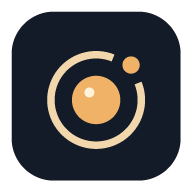

<p align="center"></p>
<h1 align="center">余光 · Afterglow</h1>
<p align="center">让闲置的安卓手机，继续守望。</p>

Afterglow turns an old Android phone into a local camera, with RTSP/H.264 + AAC, MJPEG, local MP4 recording and offline motion/sound triggers. No account, cloud service, AndroidX or third-party runtime dependencies.

## 使用

1. 安装 APK，打开「余光」，授予摄像头权限。
2. 选择摄像头，依次选择输出方向、比例、分辨率，也可输入自定义宽高，然后点击「开始」。
3. 预览展示完整输入画面；被半透明遮罩覆盖的部分会被裁掉，未遮罩区域才是远端画面。预览旁显示当前输入比例和输出尺寸。横屏时预览在左侧，设置在右侧，分别滚动。
4. 界面默认跟随手机四向旋转，不受系统旋转锁影响。推流自动摆正，但保持你选定的输出宽高；开启「方向锁定」会同时固定当前界面方向和相机校正姿态。
5. 自动方向不准时，在「校准摄像头」里添加旋转偏移，按实际镜头分别保存；「恢复自动」清除该镜头的偏移。
6. 在同一局域网的浏览器打开 `http://手机IP:8080/`，或用 VLC 打开 RTSP 地址。
7. 在「录像与检测」选择连续／事件录像、手机／外置存储及相关参数，保存后开始采集。「仅本地录像」不开放网络观看服务。
8. 需要声音时开启麦克风并授权。录像可独立选择是否保存声音；观看端选择 RTSP，MJPEG 始终无声。
9. 长说明放在右上角「帮助」，访问地址可点击复制。

新安装默认 16:9、1280 × 720、15 fps；升级保留已保存的输出选择。设备摄像头、编码器及系统后台限制会影响实际效果。
切换摄像头、输出尺寸或编码设置会重建视频链路，观看端可能短暂断开。
仅转动手机、锁定方向或校准时，下一帧应用新变换，不重启摄像头、编码器或连接。
内置 MJPEG 查看器和网页会自动重连；第三方 RTSP 播放器是否恢复由其自身行为决定。

| 用途 | 地址 |
| --- | --- |
| 浏览器观看 | `http://手机IP:8080/` |
| RTSP / H.264 | `rtsp://手机IP:8554/live` |
| MJPEG | `http://手机IP:8080/video` |
| JPEG 快照 | `http://手机IP:8080/snapshot.jpg` |
| 状态 | `http://手机IP:8080/status` |

仅开启对应输出模式时，相应地址才可用。手机之间也可以从「附近设备」进入查看。
[Home Assistant 接入说明](homeassistant/README.md)。

## 1.3.0 的改动

- 手机和系统开放的外置 SD 卡应用目录录像，支持连续与事件模式、本地回放、导出、锁定和删除。
- 连续录像默认每段 5 分钟；可自定义 10–3600 秒分段、16–2048 MiB 单段上限、1–1024 GiB 总容量、
  最低剩余空间、保留天数，以及空间不足时循环覆盖或停止。锁定片段不参加自动清理。
- 事件录像默认预录约 5 秒、最后触发后延录 15 秒，可分别设置 0–30 秒和 1–600 秒。
  预录受关键帧及 8 MiB 内存上限约束；高码率时实际预录会缩短。重复事件合并，长事件自动分段。
- 麦克风默认关闭，启用后提供 AAC-LC 单声道音轨；支持有声 RTSP、可选有声 MP4 和离线声响触发。
- 离线画面变化和声响检测可分别启用，提供灵敏度；本版不识别人、宠物或声音类别。
- 慢盘、满盘或 SD 卡移除会明确暂停录像，保留推流；麦克风采集故障会结束请求的音视频会话并提示原因。

**存储规则：**录像位于应用专属目录，卸载应用会删除；重要片段请导出到系统文件选择器指定的位置。
循环模式仅清理选定目标内本应用登记、已完成、未锁定的片段；停止模式不执行自动清理，
保留天数也只在循环模式生效。写入失败不会自动切换存储；恢复存储后保存设置或重启采集可重试。
断电可能损失正在写的片段，异常残留不会显示为已完成录像。

录像与推流共用主页的分辨率、裁剪、帧率和码率。时长到达后在下一关键帧切段；
单文件大小接近上限时提前寻找关键帧分段，未能及时获得关键帧会暂停录像。
修改录像配置、音轨或镜头会结束当前片段并短暂重启采集。

## 1.2.1 的改动

- 横屏左侧预览、右侧设置，旋转时重排原控件，保留编辑状态。
- 输出先选方向和比例，再在该比例内选择具体分辨率；常用比例包含 16:9、4:3、1:1，镜头及已保存尺寸的其他比例也会列出。
- 默认推流为 16:9，保留完整输入预览和半透明遮罩，移除裁剪黄框。
- 比例与源尺寸独立：例如 4:3 输入也可裁剪生成 16:9 输出；宽屏比例本身不会增加视野。

## 1.2.0 的改动

- 自动方向校正独立于界面，前后镜头分别计算；支持四向界面、方向锁定和每镜头校准。
- 横屏 / 竖屏 / 自定义输出尺寸，旋转手机不会交换所选输出宽高。
- 完整输入预览与实际推流共享同一份裁剪几何，遮罩覆盖的像素不会进入 RTSP、MJPEG 或快照。
- Android 5+ 增加 Camera2 采集和可访问的多镜头列表；支持指定可用的逻辑相机成员，Android 4.4 保留旧采集接口。
- 分辨率列表结合当前镜头能力，实际采集尽量采用接近传感器原始比例的流尺寸，再中心裁剪、缩放到输出尺寸。输入尺寸、完整画面比例和输出尺寸分别显示。

镜头能否使用取决于系统和厂商开放的接口；软件无法访问未开放的镜头。
「完整画面」指当前采集流尚未经过本应用裁剪的范围，并不保证包含传感器每个物理像素。
源尺寸不足时可能放大，增加输出像素不会增加实际细节。
自定义宽高必须为 16–4096 的偶数，总像素不超过 8,294,400；H.264 还需设备编码器支持该尺寸和帧率。
编码失败会显示明确错误，不会偷偷改尺寸或丢掉 RTSP 输出。

从 1.1.0 升级会保留原输出尺寸等配置，但旧的绝对旋转角不作为新自动校正偏移沿用，避免叠加旋转；必要时可重新校准。

## 1.1.0 的改动

- 余光 / Afterglow 名称、深色界面、暖色几何镜头图标，含 Android 8+ 自适应图标。
- 摄像头和旋转控制靠近预览；精简重复说明，画质参数紧凑排列。
- 设置自动生效，合并连续操作；预览丢弃旧会话的迟到画面。
- 启动、停止、重配串行执行，失败时释放已创建的摄像头、编码器、服务器和唤醒锁。
- 网页重连与会话检测；修正 MJPEG 分段边界及断连后的客户端清理。
- 修正 Android 4.4 的 H.264 编码器枚举路径，补充生命周期与真实网络协议回归测试。

## 构建

要求 JDK 17、Android SDK Platform 36、Build-Tools 36.0.0。
项目声明 `minSdk 19`、`targetSdk 33`；保留原安装包 ID `com.oldphone.ipcam`，同一签名下可覆盖升级并保留配置。
版本兼容声明不代替真机测试，尤其是相机和硬编码器的机型差异。

### Gradle

设置 `ANDROID_HOME`，或在不提交的 `local.properties` 中填写 `sdk.dir`。
仓库包含 Gradle 8.13 wrapper，首次运行会下载 Gradle 与 AGP 8.11.1 依赖。

```powershell
.\gradlew.bat assembleDebug lintDebug
```

Linux/macOS 用 `./gradlew assembleDebug lintDebug`。产物：
`app/build/outputs/apk/debug/app-debug.apk`。

### Windows 离线 SDK 工具链

已经有 SDK/JDK 时，可直接用 `aapt2 → javac → d8 → zipalign → apksigner`：

```powershell
.\build-apk.ps1 -Sdk F:\SDK -Jdk F:\SDK\jdk-17
```

输出 `dist/Afterglow-1.3.0.apk`。使用本机已有的 Android debug keystore；
若没有，先运行一次 Gradle debug 构建。签名文件、本机路径和构建目录均被 Git 忽略。
自己的正式发布应使用自行管理的签名密钥。CI 的 debug APK 与本机 APK 可能使用不同签名，不能互相直接覆盖升级。

## 验证

Windows，JDK 17、Node.js：

```powershell
.\tests\run.ps1 -JavaHome F:\SDK\jdk-17
```

测试包括方向防抖、四向像素旋转、裁剪及色度、相机平面转换、真实生命周期协调器、
回环 TCP/UDP 的 HTTP/MJPEG/RTSP 音视频交互、实际网页脚本重连、事件前后录、
录像容量和锁定保护、文件异常隔离、音频资源释放、画面变化与声音阈值。
Android 系统类在 JVM 测试中仅提供必要替身；这些测试不能验证物理摄像头、EGL、硬件编码器和 UI 绘制。
有声 MP4、音画同步、第三方 RTSP 播放器、SD 卡拔插和长时间运行仍需在目标手机验证。

参见 [生命周期测试](tests/STREAM_LIFECYCLE.md)、[观看端测试](tests/viewer/README.md)。
GitHub Actions 自动执行回归测试、构建和 Android lint，并保留 debug APK artifact。

## 网络与权限

本应用用于可信局域网。可选的访问验证仅保护 HTTP/MJPEG，RTSP 未提供认证；HTTP 本身未加密。
不要直接把这些端口映射到公网。摄像头权限用于取流，麦克风权限仅在启用声音时申请，
前台通知和唤醒锁用于维持运行，局域网扫描用于发现同网段设备。
开机启动受 Android 版本和厂商后台策略限制；需要时请在系统电池设置中允许后台运行。

仓库不包含签名密钥、个人配置或真实摄像头画面。`tools/fake_device.py` 的调试图片需自行放到被忽略的 `tools/frame.jpg`。
